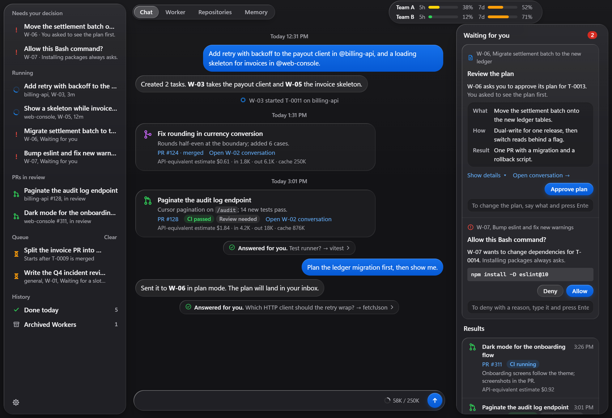

# Oh My Agent IDE

Tell a Dispatcher what needs doing in one window, and it hands the work to Worker agents. You see only the decisions that need you and the results. Built with Electron and the Claude Agent SDK; runs on Windows and macOS. The UI is in English by default, with Korean available in Settings.



The main window with sample data: the sidebar lists what waits for you, running Workers, PRs in review and the queue; the chat holds the Dispatcher conversation and result cards; the right side holds decisions (a plan to approve, a command to allow) and results.

Decisions made during implementation are in [docs/DECISIONS.md](docs/DECISIONS.md). The design system (an audit of the current UI, the v1 "Graphite Glass" spec and tokens, and a self-contained `design-system.html`) is in [docs/design-system/](docs/design-system/README.md); the app does not use it yet.

## Install

Windows: build the installer (see below) and run `release/OhMyAgentIDE-Setup-<version>.exe`. It is unsigned, so if SmartScreen appears choose "More info → Run anyway".

macOS: build a dmg on a Mac:

```bash
npm install
npm run dist:mac
```

## First run

Settings opens. Sections are on the left. Changes are saved as you make them; a new IDE home folder is used after a restart.

1. **Accounts.** Up to 4. For each Team or Enterprise account, run `claude setup-token` in a terminal and paste the token, then pick its plan. To use the Claude Code login already on this PC, choose "Use this PC's login". To use a ChatGPT account, install the Codex CLI, sign in with `codex login`, and choose "ChatGPT (Codex)": the app runs your Codex CLI and stores no token for it. One ChatGPT account can be registered.
2. **General.** Language, IDE home folder (clones, worktrees, results and memory live here; default `~/oh-my-agent-ide`), company GitHub host such as `github.company.com` (log in first with `gh auth login --hostname github.company.com`), and how long idle Workers stay before they are archived.
3. **Notifications.** OS notifications on or off, the sound played when a decision is needed (built-in chime, bell, ping, your own file, or none), and its volume.
4. **Memory.** Optional remote for the memory git repository: the clone URL of a private repository, such as `https://github.com/me/agent-memory.git` or `git@github.com:me/agent-memory.git`. The app merges what the remote holds and pushes what it lacks at launch and after each memory change, so several PCs can share one repository; the result of the last sync is shown under the address. Leave it empty to keep memory in a local git repository only.
5. **Models.** The model for the Dispatcher, for Workers, and for design work, picked from the models your accounts can use. The list is read from the Anthropic API, so new models appear without an app update.
 With a ChatGPT account registered, the list also has the models Codex offers it; an agent set to one of them runs on Codex. On Codex there is no plan-first step, no self-review and no cost estimate, and a usage limit makes the work wait for the reset.

## Using it

- Say what needs doing in the chat. Use `@repo` to pick a repository.
- Register repositories by asking, for example: "Clone github.company.com/payments/billing and register it. It runs the settlement batch."
- Drag files or folders onto the chat (or onto an open Worker conversation) to attach their paths. Agents read them from where they are; nothing is copied.
- When a follow-up needs a change that is still in an open PR, say so ("after that PR is merged, …"). The task waits and starts by itself once the PR is merged.
- At most 3 Workers run at once; change it with "Workers at once" (1 to 8) in Settings → Models. More tasks wait in the sidebar's Queue as "Waiting for a slot 3/3" and start by themselves, the longest waiting first, when one finishes. A Worker waiting for your answer keeps its slot, and messages to Workers already at work go out right away.
- Click a task in the sidebar's Queue to see why it waits and what starts it: a free slot (with its place in line), a usage limit (with the account and the time it resets), or another task's PR to merge. The card at the top of the Worker view also shows its request and the tasks waiting on it. When the task it waits for failed or was cancelled, the card says in red that this one is cancelled too. Hover over a queue row for the same reason.
- To cancel a task that is still waiting (for a free Worker slot, for a usage limit to reset, or for a merge), use the × on its row in the sidebar's Queue or "Cancel task" in the Worker view; "Clear" on the Queue heading cancels them all. You can also ask in the chat ("clear the queue"). Tasks waiting on it are cancelled too. Its branch is cleaned up unless it holds commits or uncommitted changes, and an open PR is left open.
- The right side collects decisions waiting for you, results (PR links and result files), and answers the Dispatcher gave on your behalf. Correct an auto-answer with the pencil button or by right-clicking it.
- Every decision says why it needs you: which Worker asks to do what for which task, and why it is not decided without you (the always-ask rule and its risk, a path outside the Worker's folders, or what memory could not answer). The sidebar row and the OS notification show the same reason.
- A new task goes to an idle Worker that already worked on the same repository, preferring one that worked on the same area of the code. A Worker that is busy, has other open work, or whose context is at 60% of the window or more is passed over. A new Worker is created only when none fits, or when you ask for a fresh one.
- The Dispatcher and Workers talk to each other. The Dispatcher can ask a Worker a question or read its conversation, and a Worker can answer, ask for something or report that it is blocked without finishing its task. When an answer, a request or a result comes in, the Dispatcher tells you what it means without waiting for your next message; the chat shows one line per exchange. A Worker that waits for the Dispatcher reads "Waiting for the Dispatcher" and keeps its slot; you can also answer it yourself in its conversation.
- Each result shows what its task cost as an "API-equivalent estimate" (Claude Code's figure at API list prices) with its input, output and cache tokens. Subscription accounts are not billed this amount, and nothing is held back because of it. The Dispatcher's own cost this month is in the menu of the context indicator next to the send button.
- When an answer or a correction holds a fact worth reusing, a "Remember this?" card offers to save it to memory (save, edit, or dismiss). It appears only when the check is confident, at most once per task; turn it off in Settings > Memory.
- In the Worker view, select a Worker to see its conversation with the Dispatcher and message it directly. "Done today" and "Archived Workers" in the sidebar filter the Worker list; "All" shows every Worker again.
- Long conversations (the chat and a Worker's) open at their latest messages; scroll up for earlier ones. Long lists (results, auto-answers, archived Workers, a repository's tasks, memory search) end in "Show more".
- Say "plan first" (or ask for a large change) and the Worker plans before touching code. The plan arrives in the decision inbox: approve it, or type what to change.
- In a Worker's conversation, the Changes tab shows what it changed on its branch, committed or not, before a PR exists.
- In the Changes tab, click a line of the diff to comment on it. Comments stay under their lines until you press "Send N comments", which sends them to the Worker as one message with each file, line and comment.
- Before opening a PR, a Worker has a reviewer on the Dispatcher's (lighter) model check its diff, fixes what holds up, and notes the result in one line of the PR body. Small changes (up to 30 lines in up to 3 files, or docs only) skip it. Turn it off with "Self-review before PR" in Settings → Models.
- Open PRs show whether they are ready to merge: CI, conflicts and review, on the result cards and in the Worker view. When CI fails, the Worker gets the end of the failed GitHub Actions log (or just the link, for other CI) and fixes it on the same branch, up to 3 times per task; after that the decision inbox asks whether to keep going.
- When an open PR conflicts with its base branch, its Worker merges the base in and resolves the conflict on the same branch (no rebase, no force-push), and asks when a conflict needs a decision. When a PR is ready (CI passed or none, no conflicts, no review still asked for), a Merge button appears next to its badges; it asks once, then merges the way the repository allows.
- In the Repositories view, a setup command (for example `npm ci`) runs in every new worktree. `ROOT_PATH` points at the main checkout, so `cp $env:ROOT_PATH/.env .` (Windows) or `cp "$ROOT_PATH/.env" .` copies local config.
- In the Memory view, review and edit preferences, repository notes and past decisions. Opening a repository note offers a button to have a Worker open a PR adding it to that repository's CLAUDE.md.

### Shortcuts

| Key | Action |
|---|---|
| ⌘/Ctrl+1–4 | Switch view |
| Mouse back button, Alt+← (⌘[ on macOS) | Back to the previous screen |
| Mouse forward button, Alt+→ (⌘] on macOS) | Forward again |
| ⌘/Ctrl+, | Settings |
| ⌘/Ctrl+Z | Undo clearing a list |
| Enter | Send |
| Shift+Enter | New line |

## Development

```bash
npm install
npm run typecheck
npm start
```

Build output goes to `dist/`, installers to `release/`.

- `npm run dist:win` builds the Windows installer.
- `npm run dist:mac` builds the macOS dmg (on a Mac).
- To keep settings and data in another folder, set `OMA_DATA_DIR=<folder>`. Its `settings.json` holds `home`.

### Layout

| Path | What it does |
|---|---|
| `src/main/agents/session.ts` | One Claude Code session: account failover, compaction (80% of a 250K window, and by Claude Code mid-turn), usage reading |
| `src/main/agents/dispatcher.ts` | The Dispatcher session, its task-board MCP tools, and the turns Worker news starts |
| `src/main/agents/workers.ts` | Creating and assigning Workers, questions and permissions, talking to the Dispatcher, results, tasks that wait for a merge |
| `src/main/agents/advisor.ts` | Decides whether a Worker's question can be answered from memory |
| `src/main/agents/memorySuggest.ts` | Offers to remember reusable facts from decision answers and corrections |
| `src/main/agents/permissions.ts` | Actions that always ask |
| `src/main/accounts.ts` | Account pool, usage, assignment |
| `src/main/prmonitor.ts` | PR status, cleanup after merge, review comments, failed CI |
| `src/main/prchecks.ts` | Merge readiness from PR checks, which CI failures to hand back, log tails |
| `src/main/attachments.ts` | Paths of files dropped into messages |
| `src/main/memory.ts` | Markdown memory with git history |
| `src/shared/i18n.ts` | English and Korean UI text |
| `src/shared/askWhy.ts` | Why each decision needs the user, for its card, sidebar row and notification |
| `src/shared/routing.ts` | Which idle Worker takes a new task, or whether to create one |
| `src/renderer/` | The UI |
| `src/main/agents/selfReview.ts` | Self-review before a PR: the task-message rule, skip limits, reviewer subagent |
| `resources/plugin/` | Skills every Worker gets: token-saving habits and the self-review step |
